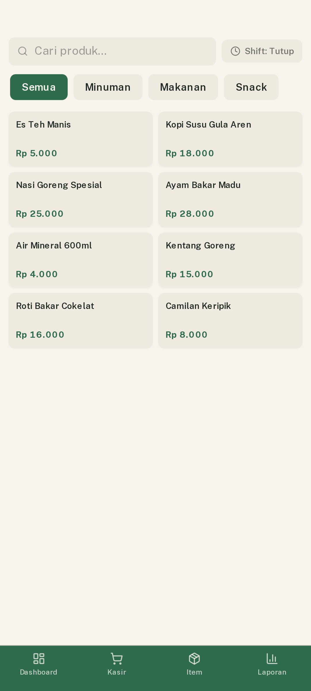
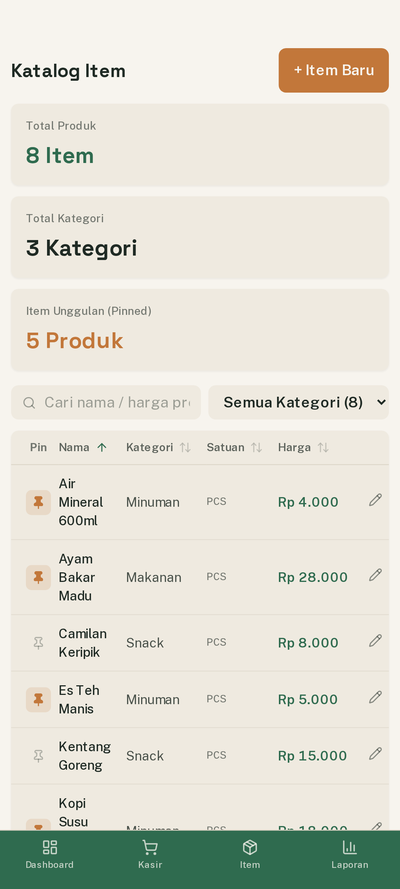
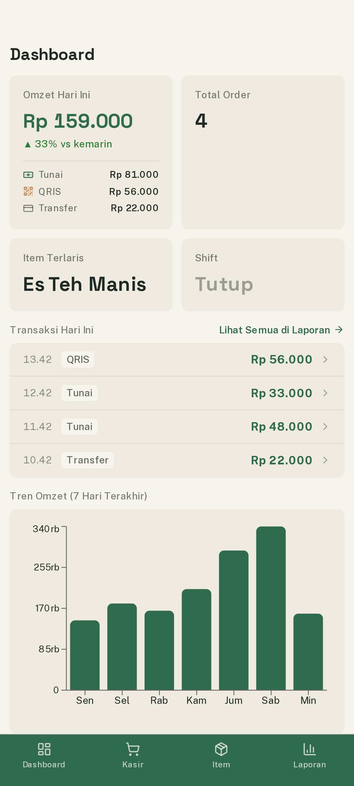
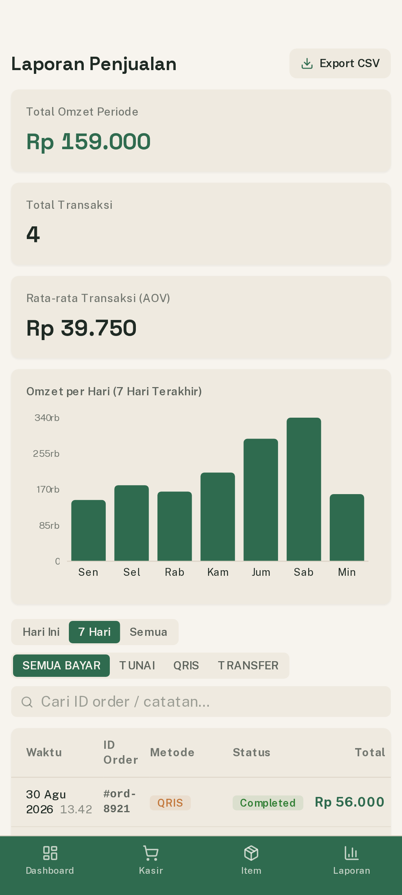

<p align="center">
  
</p>

<h1 align="center">gPOS Mobile</h1>

<p align="center">
  <strong>Sistem Kasir (Point of Sale) Native Android Offline-First</strong><br>
  Dibangun dengan Tauri v2, Rust Core, SQLite, dan React 19 untuk performa tinggi, mandiri, dan responsif.
</p>

---

## Ringkasan

gPOS Mobile adalah aplikasi kasir mandiri (*standalone mobile POS*) yang dirancang khusus untuk perangkat Android dengan pendekatan **offline-first**. Aplikasi ini menggabungkan mesin backend berbasis Rust dan embedded database SQLite yang berjalan langsung di perangkat dengan antarmuka modern berbasis React 19 dan Tailwind CSS v4.

Aplikasi beroperasi secara penuh tanpa konektivitas internet, menyimpan seluruh data transaksi secara lokal, dan menyediakan fitur sinkronisasi otomatis saat jaringan internet kembali terhubung.

---

## Fitur Utama

### 1. Kasir (Point of Sale)
- **Katalog & Navigasi Cepat:** Pencarian produk instan serta tab kategori dengan navigasi sentuh yang responsif.
- **Keranjang Belanja Mobile:** Penyesuaian kuantitas, catatan khusus per item (misal: tingkat kepedasan, tanpa es), dan kalkulasi total otomatis.
- **Metode Pembayaran:** Mendukung Tunai, QRIS, dan Transfer Bank.
- **Kalkulasi Uang & Kembalian:** Tombol nominal cepat dan perhitungan uang kembalian secara *real-time*.
- **Cetak Struk Fisik:** Terintegrasi dengan printer thermal (58mm / 80mm) melalui Android PrintManager untuk koneksi Bluetooth, Wi-Fi, atau simpan ke PDF.
- **Manajemen Shift:** Buka dan tutup shift kasir dengan pencatatan modal awal kasir (*cash float*).

<p align="center">
  
</p>

### 2. Katalog Produk (Item)
- Pengelolaan produk barang dan jasa beserta kategori (tambah, ubah, dan hapus).
- Fitur Pin Unggulan untuk menempatkan item terlaris di bagian atas layar kasir.
- Pengurutan interaktif berdasarkan nama, kategori, satuan, dan harga.
- Dialog konfirmasi pengamanan sebelum menghapus data produk.
- Ringkasan total produk, jumlah kategori, dan item unggulan.

<p align="center">
  
</p>

### 3. Dashboard Analitik
- Ringkasan finansial harian: Total Omzet Hari Ini, Jumlah Pesanan, Item Terlaris, dan Status Shift Kasir.
- Rincian penerimaan pendapatan berdasarkan metode pembayaran (Tunai vs QRIS vs Transfer).
- Visualisasi grafik batang tren omzet harian 7 hari terakhir.
- Riwayat transaksi harian dengan modal rincian pesanan interaktif.

<p align="center">
  
</p>

### 4. Laporan Penjualan
- Ringkasan performa finansial: Total Omzet Periode, Total Transaksi, dan Rata-rata Belanja (*AOV*).
- Grafik tren penjualan mingguan yang dinamis.
- Filter transaksi berdasarkan rentang waktu (Hari Ini, 7 Hari, Semua) dan metode pembayaran.
- Ekspor data transaksi ke format CSV dengan integrasi langsung ke Android Share Sheet.
- Fitur Reset Database dengan dialog konfirmasi pengamanan.

<p align="center">
  
</p>

---

## Arsitektur & Teknologi

- **Backend & Core:** Rust 2021, Tauri v2 Mobile Runtime, SQLx, SQLite (`gpos.db`).
- **Frontend:** React 19, TypeScript, Vite 6, Tailwind CSS v4, Zustand (State Management), Recharts.
- **Native Android Bridge:**
  - Android `PrintManager` untuk pencetakan struk thermal.
  - Android `FileProvider` dan `DownloadListener` untuk ekspor CSV.
  - Window Insets Controller untuk integrasi status bar dan safe area.
- **Tipografi:** Space Grotesk (angka kasir & judul) dan Public Sans (teks isi) yang tersimpan 100% offline.

---

## Panduan Menjalankan

### Prasyarat
- Node.js (versi 18 LTS atau lebih baru) dan pnpm
- Rust toolchain dengan target Android (`aarch64-linux-android`)
- Java Development Kit (JDK 17)
- Android SDK & NDK

### 1. Menjalankan Mode Pengembangan (Web Preview)
```bash
pnpm install
pnpm dev
```

### 2. Menjalankan di Perangkat Android (USB Debugging)
```bash
export JAVA_HOME=/usr/lib/jvm/java-17-openjdk
export ANDROID_HOME=$HOME/Android/Sdk
export NDK_HOME=$ANDROID_HOME/ndk/27.2.12479018

pnpm tauri android dev
```

---

## Kompilasi APK Rilis (Production Build)

Untuk menghasilkan paket APK Release teroptimasi untuk arsitektur 64-bit ARM (`arm64-v8a`):

```bash
export JAVA_HOME=/usr/lib/jvm/java-17-openjdk
export PATH=$JAVA_HOME/bin:$PATH
export ANDROID_HOME=$HOME/Android/Sdk
export NDK_HOME=$ANDROID_HOME/ndk/27.2.12479018

pnpm tauri android build --target aarch64 --apk --split-per-abi
```

Berkas APK rilis tersimpan pada:
```
src-tauri/gen/android/app/build/outputs/apk/arm64/release/app-arm64-release.apk
```

---

## Struktur Direktori

```
gposmobile/
├── assets/
│   └── screenshots/          # Tangkapan layar antarmuka aplikasi (1080p mobile)
├── public/
│   ├── fonts/                # Berkas font lokal Space Grotesk & Public Sans
│   ├── favicon.svg           # Favicon gPOS
│   └── logo.png              # Logo resmi gPOS
├── src/
│   ├── components/           # Komponen UI modular (Sidebar, AppShell, Modal, dll)
│   ├── lib/                  # Klien API, store state, utilitas format
│   ├── pages/                # Halaman aplikasi (Dashboard, Kasir, Item, Laporan)
│   ├── App.tsx               # Root router aplikasi
│   ├── index.css             # Konfigurasi Tailwind v4 & tipografi
│   └── main.tsx              # Entry point React
├── src-tauri/
│   ├── gen/android/          # Proyek Android Gradle
│   ├── icons/                # Aset launcher icon multi-resolusi
│   ├── src/
│   │   ├── commands/         # Handler perintah IPC Tauri (Items, Orders, Reports)
│   │   ├── db.rs             # SQLite pool & schema migration
│   │   ├── models.rs         # Data structures Rust
│   │   ├── lib.rs            # Application builder
│   │   └── main.rs           # Binary entry point
│   ├── Cargo.toml            # Manifest dependensi Rust
│   └── tauri.conf.json       # Konfigurasi Tauri
├── package.json              # Dependensi Node.js
└── README.md                # Dokumentasi proyek
```

---

## Lisensi

Proyek ini dilisensikan di bawah lisensi MIT.
